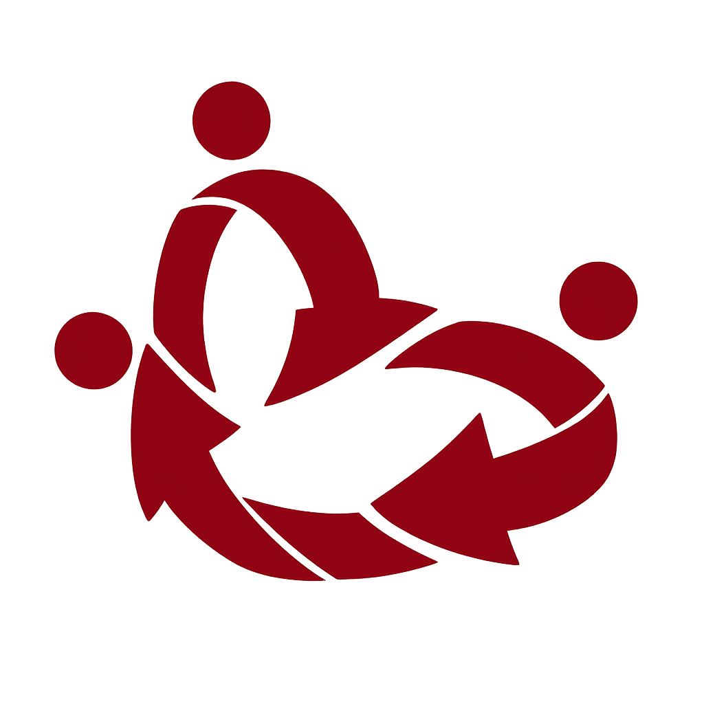
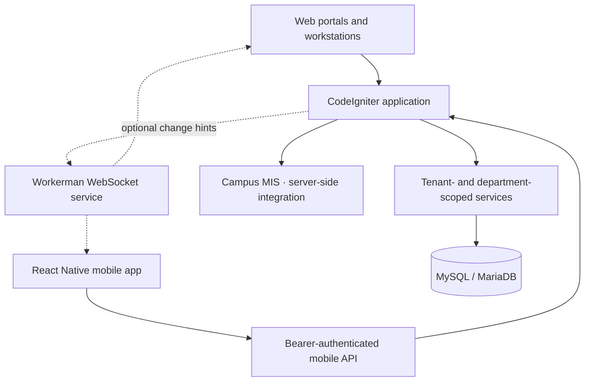

<div align="center">
  <picture>
    <source media="(prefers-color-scheme: dark)" srcset="public/assets/img/brand/synapse-white.png">
    <source media="(prefers-color-scheme: light)" srcset="public/assets/img/brand/synapse-maroon.png">
    
  </picture>

  <h1>SYNAPSE</h1>
  <p><strong>Connected campus care. Coordinated university operations.</strong></p>
  <p>A university platform for health services, guidance and counseling,<br>department collaboration, and facilities operations.</p>

  <p>
    <a href="https://github.com/rafael-fu2025/synapse_ci/actions/workflows/tests.yml"></a>
    <a href="https://github.com/rafael-fu2025/synapse_ci/actions/workflows/mobile.yml"></a>
  </p>

  <p>
    <a href="#overview">Overview</a> ·
    <a href="#getting-started">Getting started</a> ·
    <a href="#mobile-app">Mobile app</a> ·
    <a href="#documentation">Documentation</a> ·
    <a href="#verification">Verification</a>
  </p>
</div>

---

## Overview

SYNAPSE brings student and employee self-service together with authorized Clinic, Guidance, and BMG Facilities workstations. Built for Foundation University, it connects appointments, queues, care coordination, communication, and operational records while keeping departmental access and confidential records separate.

The platform includes a server-rendered web application, a versioned mobile API, and a native React Native companion app. Staff can move between their personal and authorized work contexts without treating operational access as permission to view every record.

> [!IMPORTANT]
> This repository is under active development. Implemented features are not a blanket production-readiness or compliance certification. Mobile Workspace, push delivery, AI integrations, and hardware operation have separate configuration and deployment gates. Consult the relevant runbooks before enabling them.

## Capabilities

| Workspace | Key capabilities |
| --- | --- |
| **Personal portal** | Appointment requests and cancellation, queue tickets, visit history, health summary, announcements, identified surveys, notifications, and profile settings. |
| **Clinic** | Patient directory, consultation workflows, vitals, health charts, appointment management, live queue boards, and batch-based medicine inventory with first-expiry-first-out dispensing. |
| **Guidance & counseling** | Case and session management, encrypted counseling notes, follow-up commitments, scheduling, identified surveys, and a reusable question bank. |
| **Care coordination** | Clinic–Guidance referrals with explicit acknowledgment, review, handoff, and closure workflows. Confidential clinical records remain separately authorized. |
| **Team collaboration** | Department-scoped tasks, checklists, comments, activity, calendar events, and chat with mentions, replies, and task references. Teams is not a clinical record store. |
| **BMG Facilities** | Composting drum and batch records, rotation schedules, controller registration, command/report history, and guarded USB commissioning workflows. |
| **Administration** | Employee access management, login carousel content, operational reports, notification workflows, and permission-controlled audit views. |

### Native mobile experience

- **Personal:** Home, Visits, Queue, and Profile, with announcements, surveys, notifications, and account settings.
- **Work:** Team Board, My Tasks, Team Chat, and Team Calendar for authorized unit members.
- **Shared interaction patterns:** light/dark themes, reduced-motion support, guarded draft navigation, keyboard-aware forms, sheets, and confirmation dialogs.
- **Session boundaries:** protected query data and drafts stay in memory; refresh credentials use the device keychain. Offline mutation queues are not supported.

Staff queue monitoring on mobile is **read-only**. Team attachments, direct messages, presence, clinical links, and recurring events remain outside the current scope.

## Architecture



| Layer | Technology |
| --- | --- |
| Backend | PHP, CodeIgniter 4.7, MySQL/MariaDB |
| Web interface | Server-rendered PHP, Bootstrap/NiceAdmin, HTMX, Alpine.js |
| Native mobile | React Native 0.88, React 19.3, TypeScript, React Navigation, TanStack Query |
| Optional realtime | Workerman WebSockets; authorized HTTP snapshots remain the source of truth |
| Verification | PHPUnit, isolated database fixtures, browser interaction tests, Jest, TypeScript, ESLint, GitHub Actions |

### Data and access boundaries

- Tenant, department, ownership, and role checks are enforced server-side—not just through hidden navigation controls.
- Counseling notes and identified survey responses use authenticated encryption with separately managed application keys.
- Browser mutations use CSRF protection; the mobile API uses bearer authentication and session-bound response checks.
- Selected workflows use append-only records and a versioned, tamper-evident audit chain. This is not proof against every privileged rewrite.
- External integrations require explicit configuration. AI insights use controlled aggregate evidence and human review, not diagnosis, treatment decisions, or autonomous actions.

See [session security](docs/SESSION_SECURITY.md), [web security](docs/WEB_SECURITY.md), and [audit ledger boundaries](docs/AUDIT_LEDGER.md) for the implementation details and remaining limits.

## Getting started

### Requirements

| Component | Requirement |
| --- | --- |
| PHP | A security-patched supported branch satisfying `composer.json` and the [repository runtime gate](tools/php-security-baseline.php). Current patch floors: 8.2.35, 8.3.36, 8.4.27, or 8.5.12 within their respective branches. |
| Composer | Composer 2 |
| Database | MySQL or MariaDB, using MySQLi, InnoDB, and strict SQL mode. CI uses MariaDB 10.11. |
| PHP extensions | `intl`, `mbstring`, `mysqli`, `curl`, and OpenSSL; SQLite support for isolated fixtures. GD with JPEG/PNG/WebP support is required for profile photo processing. |
| Mobile tooling | Node.js and the native platform toolchain; see [mobile setup](mobile/README.md). |

PDF report generation additionally requires a configured local LaTeX runtime. Realtime, push, AI, and device commissioning have their own prerequisites; they are not required just to start the web application.

### 1. Install dependencies

```sh
git clone https://github.com/rafael-fu2025/synapse_ci.git
cd synapse_ci
composer install
cp .env.example .env
```

On PowerShell, use `Copy-Item .env.example .env` instead of `cp` if preferred. Do not overwrite an existing private `.env`.

### 2. Configure a local environment

Create a **dedicated empty local database** and update your private `.env` with:

- `CI_ENVIRONMENT = development`
- `app.baseURL = 'http://127.0.0.1:8080/'`
- The `database.default.*` connection settings for that database.
- Independent `COUNSELLING_KEY` and `SURVEY_KEY` values, each exactly **64 hexadecimal characters**.

Generate the framework key:

```sh
php spark key:generate
```

For a **fresh installation only**, run the following separately for each application key and store the results privately:

```sh
php -r "echo bin2hex(random_bytes(32)), PHP_EOL;"
```

The framework's `encryption.key` does **not** replace the counseling or survey keys. Never commit keys, credentials, tokens, or database dumps. Existing encrypted data requires the original historical versioned keys; do not regenerate them as a setup or recovery shortcut.

Campus MIS authentication needs authorized server-side configuration. Without it, live MIS sign-in is unavailable. Development fixture authentication is explicit and must never be enabled in production; see [employee access](docs/EMPLOYEE_ACCESS.md) and the environment template.

### 3. Initialize the fresh database

> [!WARNING]
> The following commands are for a new, disposable development installation. The permissions seeder rebuilds role mappings; it is **not** an upgrade command for an existing environment. Existing deployments require reviewed migrations, a verified backup, and an appropriate maintenance window.

```sh
php spark migrate --all
php spark db:seed PermissionsAndRolesSeeder
php spark synapse:superadmin
```

The final command prompts for the local administrator credentials. Run it in a private terminal: password input is visible. Do not pass passwords as command-line arguments or use shared example credentials.

For controlled development fixtures, follow [local test account guidance](tests/LOCAL_TEST_ACCOUNTS.md). Do not provision test identities in production.

### 4. Start the web application

```sh
php spark serve --host 127.0.0.1 --port 8080
```

Open [the local application](http://127.0.0.1:8080). Available workspaces depend on the signed-in account:

| Path | Workspace |
| --- | --- |
| `/portal` | Personal portal |
| `/clinic/queue` | Clinic workstation |
| `/guidance/cases` | Guidance workstation |
| `/facilities` | BMG Facilities |

The PHP development server is not a production deployment server. Production web servers must serve `public/`, not the repository root. Dedicated workstation hosts are documented in [portal host routing](docs/PORTAL_HOSTS.md).

## Mobile app

The companion app lives in [`mobile/`](mobile/) and uses its own dependencies and native build tooling. Android is the primary development target; iOS requires macOS, Xcode, and CocoaPods.

From `mobile/`, install dependencies and start Metro:

```sh
npm ci
npm start
```

With the local API running and **exactly one authorized Android target** connected, open another terminal in `mobile/`:

```sh
npm run android:usb
```

This prepares USB routing, builds, installs, and launches the debug app. Configure its API URL before building; changing native `.env` values requires a rebuild/reinstall, not just Fast Refresh.

| Local port | Purpose |
| --- | --- |
| `8080` | PHP API |
| `8081` | Optional realtime WebSocket |
| `8082` | Internal realtime publisher—do not expose or forward to devices |
| `8083` | Metro |

Follow the [mobile README](mobile/README.md) for runtime requirements, USB/LAN setup, diagnostics, signing, and platform configuration. See the [Workspace implementation tracker](docs/MOBILE_TEAM_WORKSPACE_IMPLEMENTATION.md) for current acceptance evidence and open native checks. Workspace rollout and Team OS push remain separately gated.

## Verification

Run checks against the documented fixtures, not operational data. CI badges report workflow status; they do not certify every legacy test, native device, deployment, or external integration.

**Backend baseline** — from the repository root:

```sh
php tools/php-security-baseline.php
php vendor/bin/phpunit --configuration phpunit.ci.xml --no-coverage
```

**Mobile baseline** — from `mobile/`:

```sh
npx tsc --noEmit
npm run lint
npm test -- --runInBand
node --test scripts/dev-tooling.test.cjs
```

Database-backed, concurrency, and browser suites have separate prerequisites and isolation rules. Use the guarded fresh-schema runner described in [Testing](docs/TESTING.md); do not run an unfiltered historical suite against a shared or operational database. Automated tests do not replace native accessibility review, release-device profiling, or deployment acceptance.

## Documentation

| Topic | Guide |
| --- | --- |
| Development and test isolation | [Testing and CI](docs/TESTING.md) |
| Mobile setup and operations | [Mobile README](mobile/README.md) · [Architecture](docs/MOBILE.md) · [API contract](docs/MOBILE_API.md) |
| Mobile Workspace readiness | [Implementation and acceptance tracker](docs/MOBILE_TEAM_WORKSPACE_IMPLEMENTATION.md) |
| Team collaboration | [Tasks, calendar, and chat](docs/TEAMS.md) |
| Scheduling and counseling | [Scheduling](docs/SCHEDULING.md) · [Guidance](docs/GUIDANCE.md) · [Question bank](docs/QUESTION_BANK.md) |
| Access and workstation routing | [Employee access](docs/EMPLOYEE_ACCESS.md) · [Portal hosts](docs/PORTAL_HOSTS.md) |
| Security boundaries | [Sessions](docs/SESSION_SECURITY.md) · [Web security](docs/WEB_SECURITY.md) · [Authorization review](docs/AUTHORIZATION_AUDIT.md) · [Audit ledger](docs/AUDIT_LEDGER.md) |
| Realtime and notifications | [Realtime setup](docs/REALTIME.md) · [Workflow notifications](docs/WORKFLOW_NOTIFICATIONS.md) · [Coverage](docs/NOTIFICATION_COVERAGE.md) |
| Optional AI insights | [Operations and deployment](docs/AI_OPERATIONS.md) · [Implemented scope and roadmap](docs/AI_INTEGRATION_PLAN.md) |
| Facilities commissioning | [BMG USB workflows and safety](docs/BMG_USB.md) |

## Contributing

Keep changes focused and include relevant regression tests. Before opening a pull request:

1. Read the guide for the affected module and its authorization, data, and migration boundaries.
2. Run the applicable checks with isolated fixtures; describe what was tested and what remains unverified.
3. Call out database migrations, configuration changes, rollout gates, and backward-compatibility implications.
4. Exclude credentials, private records, uploads, database backups, and generated build artifacts.

Do not include sensitive university, patient, counseling, or authentication data in issues, pull requests, screenshots, or logs. Coordinate security concerns privately with the repository maintainers rather than posting exploit details publicly.

## License and acknowledgments

The repository includes an [MIT license](LICENSE) with upstream CodeIgniter notices. Consult that file and the applicable third-party notices for licensing scope; bundled libraries, artwork, branding, and firmware may have separate terms.

SYNAPSE builds on CodeIgniter, React Native, Bootstrap/NiceAdmin, HTMX, Alpine.js, Workerman, and the wider open-source ecosystem.
